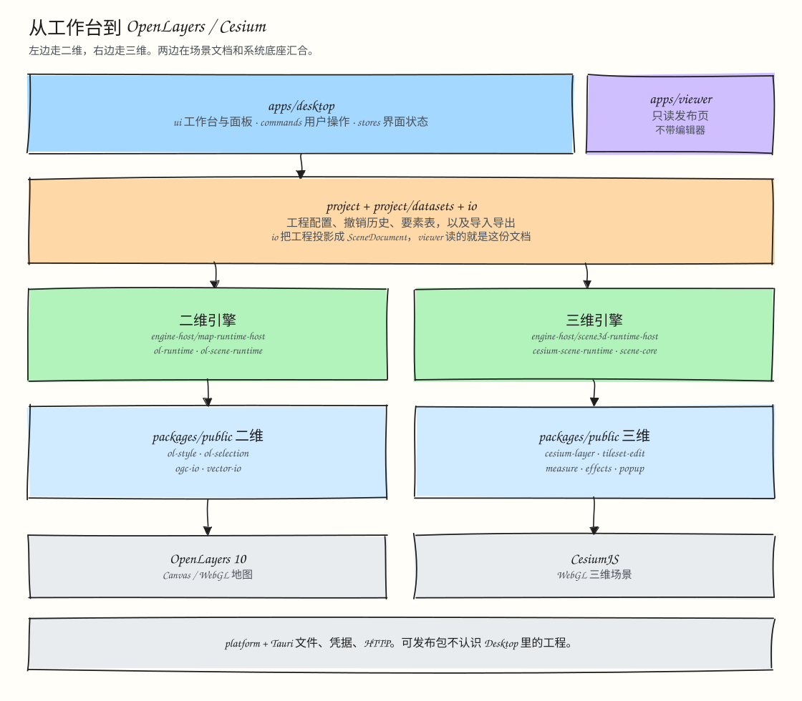
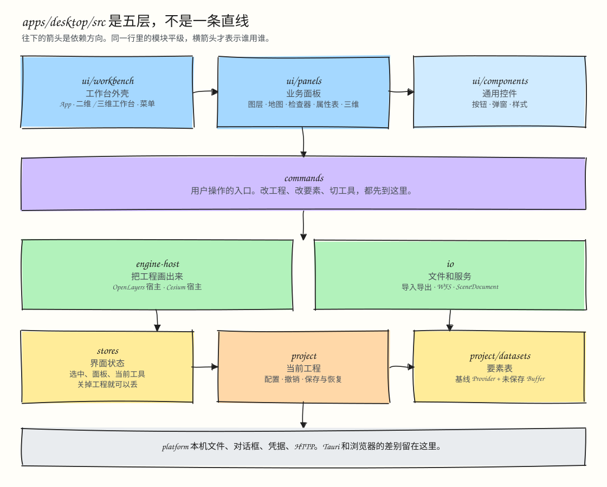

# Desktop WebGIS

一个基于 Tauri 2、React、TypeScript、OpenLayers 和 Cesium 的桌面 WebGIS 工作台，同时提供一套可复用的 GIS 包。

## 1. 从桌面界面到渲染引擎



## 2. Desktop 内部的目录与五层依赖



## 目录结构

- **`apps/desktop`**：桌面的主应用（Tauri 2 加 React），支持二维地图（`Workspace2D`）和三维场景（`Workspace3D`）两类独立的项目。内部按五层组织：`ui/{workbench,panels,components}` → `commands` → `engine-host` 与 `io` → `stores` 与 `project/{.,datasets}` → `platform`。
- **`apps/viewer`**：不依赖框架的轻量只读查看器。它配合 `scene-publisher` 生成可以静态部署的网页，同时也作为 E2E 浏览器测试中的独立渲染验收端。
- **`packages/public/*`**：11 个可以独立发布的通用 GIS 和三维能力包，不依赖内部包或应用状态：
  - 二维与 IO：`ol-style`、`ol-selection`、`vector-io`、`ogc-io`
  - 三维 Cesium：`cesium-scene-schema`、`cesium-layer`、`cesium-popup`、`cesium-measure`、`cesium-effects`、`cesium-tileset-edit`、`cesium-tileset-effects`
- **`packages/internal/*`**：9 个服务于本仓库编辑与发布流程的内部包：
  - 项目与分析：`project`、`ol-runtime`、`spatial-analysis`
  - 场景文档套件：`scene-schema`、`scene-core`、`ol-scene-runtime`、`cesium-scene-runtime`、`scene-publisher`、`scene-codegen`
- **`examples/`**：示例矢量数据（`examples/rivers.geojson`、`examples/stations.geojson`、`examples/spatial-processing/`），以及演示外部项目如何使用这些包的例子（`examples/city-3d/consumer`）。

## 常用命令

```bash
# 安装依赖
pnpm install

# 启动桌面端的 Web 开发服务
pnpm dev

# 启动 Tauri 桌面应用
pnpm tauri dev

# 检查分层与包边界（check-architecture.mjs 加 dependency-cruiser）
pnpm check:architecture

# 检查没用到的代码和多余依赖（Knip）
pnpm check:deadcode

# 全量构建与测试
pnpm build
pnpm test
```

## 文档索引

详见 [`docs/README.md`](docs/README.md) 和 [`docs/architecture/README.md`](docs/architecture/README.md)。
