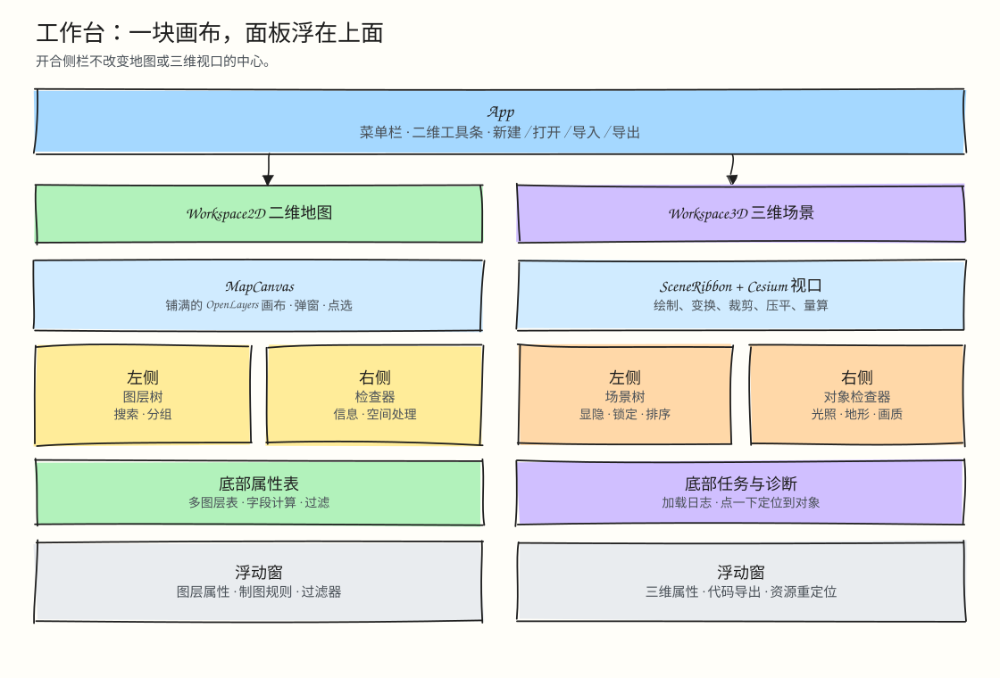
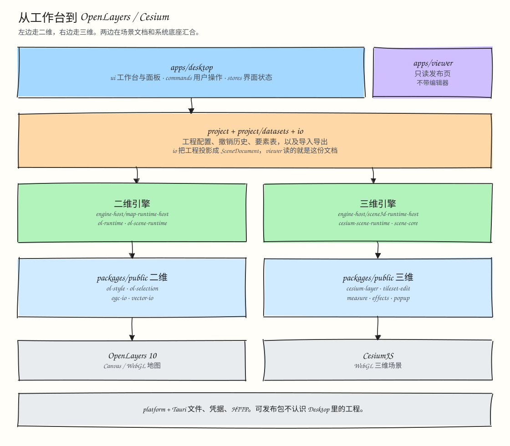
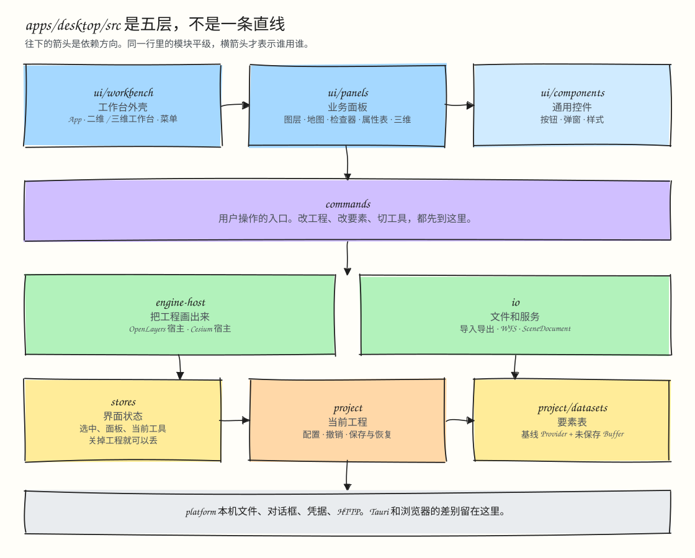

# @desktop-webgis/desktop

基于 Tauri 2 与 React 的二维地图（`Workspace2D`）和三维场景（`Workspace3D`）桌面编辑器。

## 1. UI 布局架构图



## 2. 全栈渲染调用链



## 3. `src/` 目录结构与 5 层 DAG 规则



```text
apps/desktop/src/
  ui/
    workbench/    工作台外壳与布局（App、Workspace2D、Workspace3D、Header、Left/Right/BottomPanel）
    panels/       业务功能面板（map、scene3d、layers、inspector、attribute-table、editing、processing...）
    components/   通用基础控件与样式（Button、EditorDialog、ModelessWindow、styles...）
  commands/       用户操作入口（点按钮、菜单、快捷键触发的完整动作）
  engine-host/    渲染引擎挂载宿主（OpenLayers map-runtime-host、Cesium scene3d-runtime-host）
  io/             外部矢量格式导入导出、WFS/GeoServer 请求、项目转 SceneDocument
  stores/         界面瞬态状态（Zustand：面板开合、选中集、当前工具、任务日志）
  project/        当前项目配置、统一 Undo/Redo 历史、项目保存与恢复
    datasets/     要素数据运行时（MemoryFeatureProvider 基线 + FeatureEditBuffer 增量）
  platform/       Tauri 2 与浏览器环境适配（本地文件、对话框、安全凭据、Native HTTP）
```

## 开发与验证

```bash
pnpm --filter @desktop-webgis/desktop dev
pnpm --filter @desktop-webgis/desktop exec tsc --noEmit
pnpm --filter @desktop-webgis/desktop test
pnpm --filter @desktop-webgis/desktop test:e2e
pnpm --filter @desktop-webgis/desktop build
```
