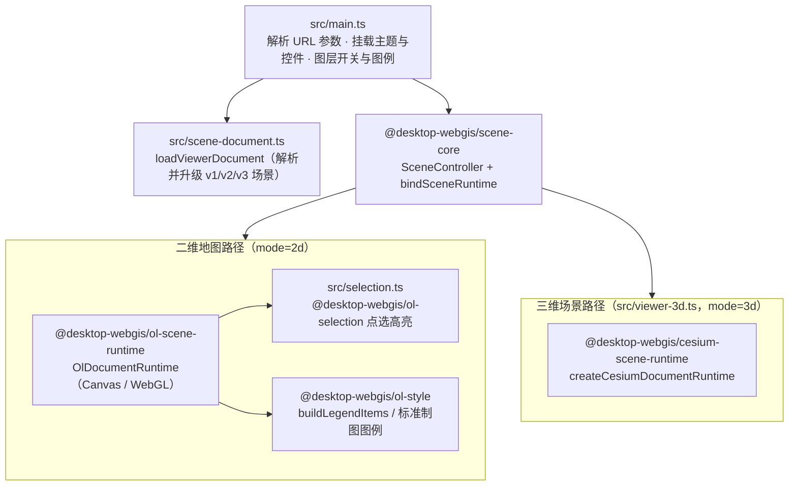

# @desktop-webgis/viewer

一个不依赖 React 和编辑器代码的轻量只读场景查看器。

## 用途

1. **静态发布运行端**：配合 `@desktop-webgis/scene-publisher`，把编辑器导出的 `SceneDocument` 打包成可以部署到任意静态服务器的网页应用。
2. **跨端渲染验收宿主**：在 E2E 测试中加载编辑器导出的 v3 `SceneDocument`（包含二维地图和三维 Cesium 场景），验证独立运行时里的实际渲染和交互是否一致。

## 架构图



## 运行与构建

```bash
pnpm --filter @desktop-webgis/viewer dev
pnpm --filter @desktop-webgis/viewer exec tsc --noEmit
pnpm --filter @desktop-webgis/viewer build
```

打开 `/?scene=./examples/v3/scene.json` 可以预览内置的 v3 示例场景；用 `mode=2d` 或 `mode=3d` 切换视图模式，二维视图支持通过 `renderer=canvas|webgl` 切换矢量渲染器。
