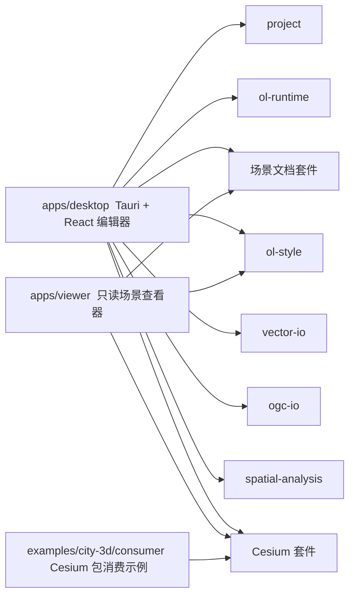
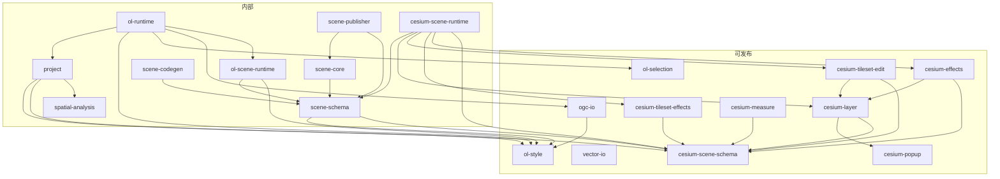
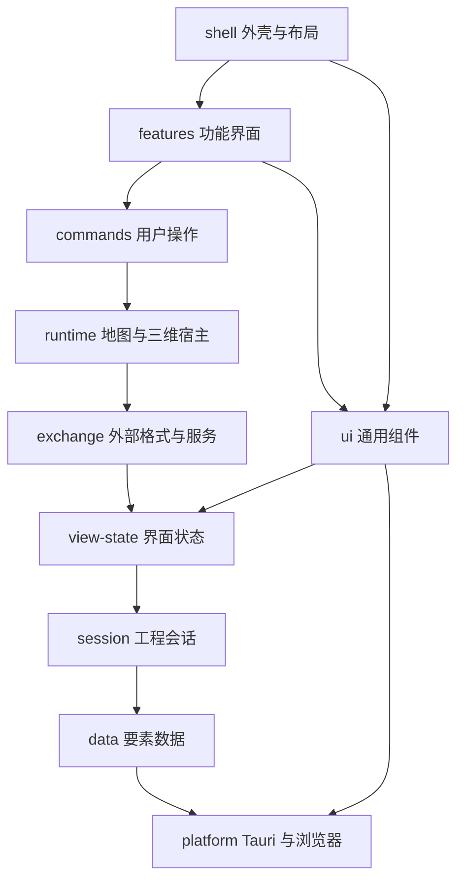
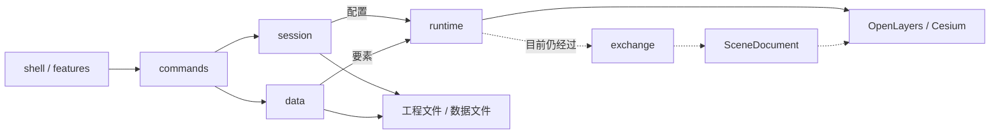

# 架构

本目录是现行架构说明。数据与编辑的保存语义见 [data-and-editing.md](data-and-editing.md)；目录分层与新代码位置见 [layers.md](layers.md)；目录迁移与执行记录见 [layering-plan.md](layering-plan.md)。

图中使用现行目录和包名。

## 系统总览

仓库里有三个应用：Desktop 编辑器、只读 Viewer、以及一个 Cesium 包的消费示例。它们共用部分包，但 Desktop 还依赖工程模型和编辑运行时。

场景文档套件包括 `scene-schema`、`scene-core`、`ol-scene-runtime`、`cesium-scene-runtime`、`scene-publisher`、`scene-codegen`。Cesium 套件包括 `cesium-scene-schema`、`cesium-layer`、`cesium-popup`、`cesium-measure`、`cesium-effects`、`cesium-tileset-edit`、`cesium-tileset-effects`。

## 包依赖

可发布包只能依赖可发布包。内部包可以依赖任何包，应用不被任何包依赖。

现行包边界：

- `vector-io` 和 `project` 不依赖 `scene-schema`。
- `ogc-io` 可发布。
- 场景文档套件为内部包（`private: true`）。
- `project` 的几何处理实现放在 `spatial-analysis`。

## Desktop 分层

依赖只能往下。`ui` 不在这条链上，`shell` 和 `features` 可以用它。

图层选择、属性表、检查器状态在 `view-state/layer-view.store.ts`，hook 为 `useLayerViewStore`。工程配置在 `session/project.store.ts`。要素运行时在 `data/feature-data.ts`。编辑历史在 `session/project-edits.ts`。

## 数据与编辑流程

用户操作经过 `commands` 进入工程会话。配置和要素数据分开持有：配置在 `ProjectStore`，每个数据源一组 Provider（原始行）加 Buffer（未提交增量），历史只有一份。工程保存只写配置；数据保存成功后才清 Buffer。

虚线是待优化路径：编辑器的二维地图现在仍把整个工程（含全部要素）转成 `SceneDocument` 再交给 `ol-runtime`。分层计划不改这条运行路径，只把转换代码放到 `exchange/`，让它在目录上不再混进编辑循环。细节见 [数据与编辑架构](data-and-editing.md)。

## 本目录其它文档

- [分层规则](layers.md)：目录职责、依赖方向、新代码放在哪里
- [数据与编辑](data-and-editing.md)：两类保存、恢复草稿、性能基线
- [统一场景文档 v3](scene-document-v3.md)：交换格式，用于导入、导出、查看器
- [项目恢复草稿](project-recovery.md)
- [本地场景资源协议](local-resource-protocol.md)
- [分层与包边界整理计划](layering-plan.md)：已完成的目录迁移与执行记录
- [2026-11 重构阶段记录](../archive/refactor-2026-11/refactor-handoff-2026-11-02.md)：已完成的数据与编辑重构交接
