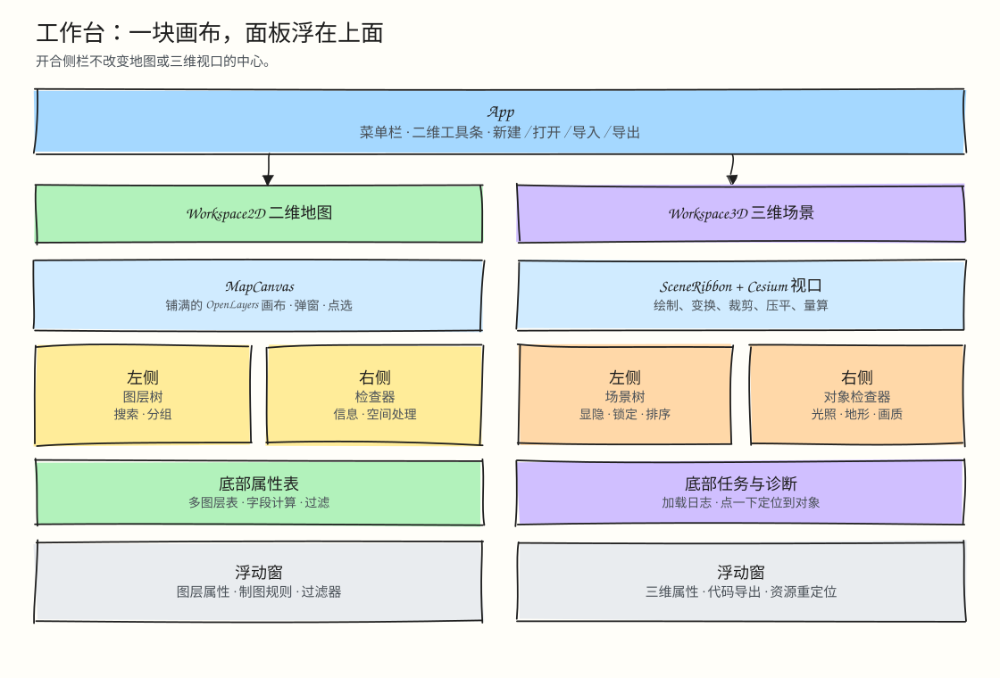
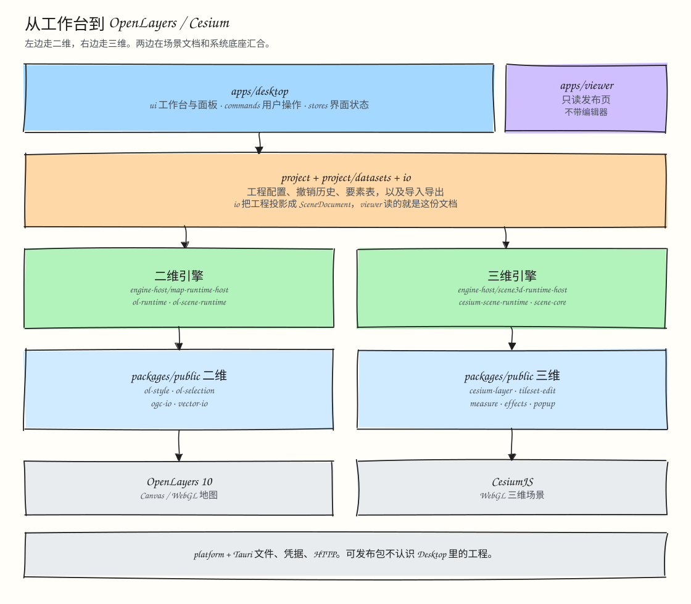
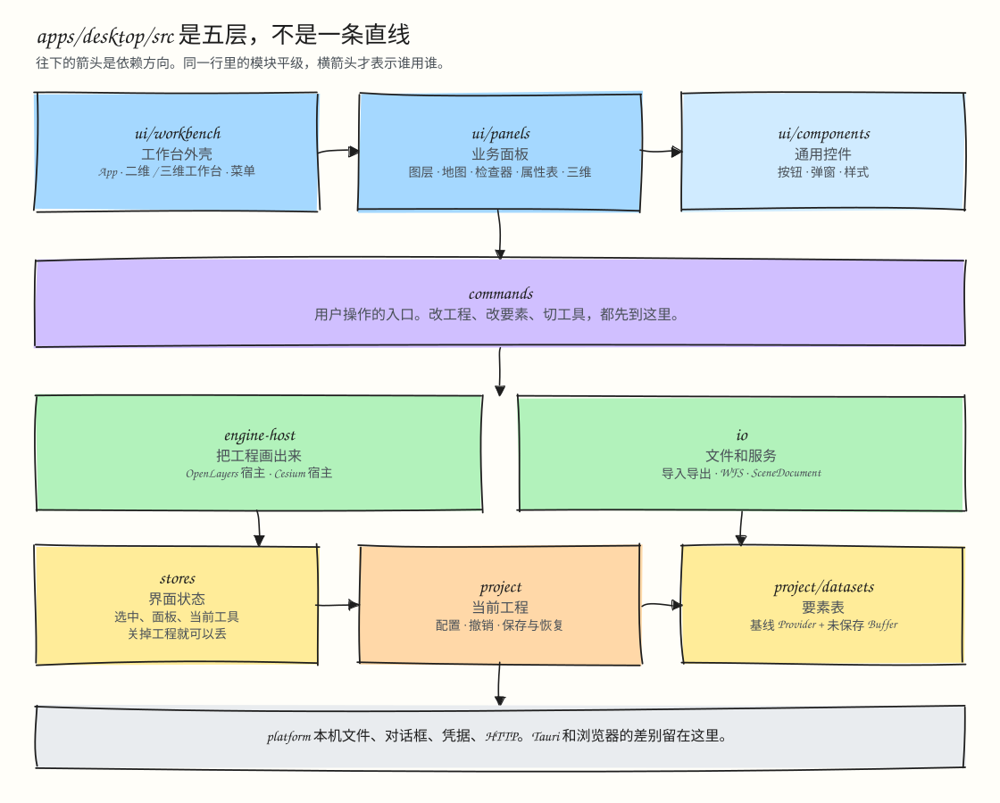

# 架构总览

本目录说明仓库的整体架构。目录职责和依赖规则见 [layers.md](layers.md)，数据与编辑的保存规则见 [data-and-editing.md](data-and-editing.md)。

## 1. Desktop 的界面结构

Desktop 的界面由三部分组成：顶层统一的应用壳（`ui/workbench/App.tsx`）、按项目类型切换的工作台（`Workspace2D` / `Workspace3D`），以及覆盖在画布上的停靠面板（`LeftPanel` / `RightPanel` / `BottomPanel`）。面板浮在画布之上，打开、关闭或调整面板都不会改变地图和三维视口的中心位置与尺寸。

界面与下层状态、命令之间的关系是单向的：

- `ui/workbench` 和 `ui/panels` 只**读取并订阅** `stores`（临时界面状态）、`project`（项目配置）和 `project/datasets`（要素数据）。
- 需要修改项目配置或要素数据时，一律经由 **`commands/*`**，由命令写入 `project` / `project/datasets`，或驱动 `engine-host`。

---

## 2. 从桌面界面到渲染引擎

下面这张图把 Desktop 内部分层、`packages/internal` 的项目与场景运行时、`packages/public` 的引擎能力包，一直到最底层的 OpenLayers / Cesium 和 Tauri / 浏览器宿主串成一条链路：

---

## 3. Desktop `src/` 的五层依赖

Desktop 内部并不是一条九层直线，而是自上而下的**五层结构**，其中第 3、4 层各含两块平级模块。这套规则由 `pnpm check:architecture` 和 `dependency-cruiser` 一同检查：

---

## 4. 仓库与 `packages/` 的边界

仓库包含两个应用、一套示例，以及按 `packages/public`（可独立发布）和 `packages/internal`（仓库内部）划分的 20 个包：

- **`apps/desktop`**：Tauri 加 React 的桌面编辑器，负责二维制图、要素编辑、空间分析和三维场景编辑。
- **`apps/viewer`**：轻量的只读查看器，不依赖 React 和编辑器代码。它有两个用途：
  1. **静态发布运行端**：配合 `packages/internal/scene-publisher`，把导出的 `SceneDocument` 打包成可以独立部署的静态网页；
  2. **跨端渲染验收宿主**：在 E2E 测试中验证编辑器导出的二维、三维场景 JSON 在独立运行时里的实际渲染效果。
- **`examples/city-3d/consumer`**：一个独立示例，验证外部项目能否直接使用 `packages/public/cesium-*` 套件。

| 分组 | 目录 | 依赖规则 | 包含的包 |
| --- | --- | --- | --- |
| **可发布的通用包** | `packages/public/*` | 只能依赖 `packages/public/*`，不认识 Desktop 的项目状态 | `ol-style`、`ol-selection`、`vector-io`、`ogc-io`、`cesium-scene-schema`、`cesium-layer`、`cesium-popup`、`cesium-measure`、`cesium-effects`、`cesium-tileset-edit`、`cesium-tileset-effects` |
| **仓库内部包** | `packages/internal/*` | 可以依赖任意包，但不能反向依赖 `apps/*` | `project`、`ol-runtime`、`spatial-analysis`、`scene-schema`、`scene-core`、`ol-scene-runtime`、`cesium-scene-runtime`、`scene-publisher`、`scene-codegen` |

---

## 5. 数据与编辑流程

用户操作先经过 `commands` 进入 `project`。项目配置（`useProjectStore`）和要素数据（`project/datasets` 下的 `RuntimeFeatureData`，每个数据源由 `MemoryFeatureProvider` 和 `FeatureEditBuffer` 组成）分开存放，但共用同一条撤销栈（`project/project-edits.ts`）。保存项目（Ctrl+S）只写配置；数据保存成功之后，才会清空对应数据源的 Buffer。

## 本目录的其它文档

- [分层规则](layers.md)：目录职责、依赖方向、新代码放在哪里
- [数据与编辑](data-and-editing.md)：两类保存、恢复草稿、性能数据
- [统一场景文档 v3](scene-document-v3.md)：交换格式，用于导入、导出和查看器
- [项目恢复草稿](project-recovery.md)
- [本地场景资源协议](local-resource-protocol.md)
- [分层与包边界整理记录](layering-plan.md)：目录迁移过程与执行记录
