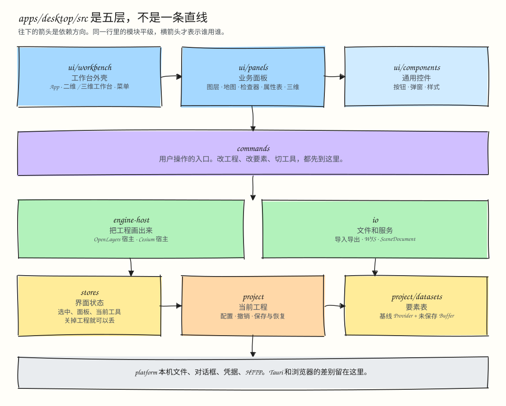

# 代码分层与包边界

本文说明 Desktop 的目录结构、真实的五层依赖关系，以及 `packages/` 下 `public` 与 `internal` 两类包的边界。新增或移动代码前先看这里。

本文不使用“领域层”“Domain”这类说法，目录和文档直接按职责命名。

## Desktop 目录与五层架构



`apps/desktop/src/` 下只有 **7 个顶层目录**，对应自上而下的 **5 层结构**。其中第 3 层和第 4 层各有两块平级的模块：

```text
apps/desktop/src/
  ui/                 第 1 层：界面层。React 组件与样式，只读订阅状态，修改通过 commands
    workbench/          工作台外壳与布局：App、Workspace2D、Workspace3D、Header、左右下停靠框
    panels/             各业务功能面板：map、scene3d、layers、inspector、attribute-table、editing、processing 等
    components/         通用基础控件与样式，不认识项目和数据：Button、EditorDialog、ModelessWindow 等

  commands/           第 2 层：命令层。用户操作入口，菜单、工具栏、快捷键和面板的写操作都从这里进

  engine-host/        第 3 层左：引擎宿主层。创建 OpenLayers / Cesium 实例，把项目配置和数据同步给引擎
  io/                 第 3 层右：导入导出与服务层。外部矢量格式、WFS/GeoServer 请求、项目转 SceneDocument、代码导出

  stores/             第 4 层左：界面状态层。Zustand 里的临时界面状态：面板开合、选中集、属性表、当前工具，关掉项目即可丢弃
  project/            第 4 层右：项目与数据层。当前项目配置（project.store）、唯一的撤销历史（project-edits）、保存与崩溃恢复
    datasets/           要素数据运行时：每个数据源一个 MemoryFeatureProvider（基线）加一个 FeatureEditBuffer（未提交增量）

  platform/           第 5 层：系统底座。Tauri 2 与浏览器的差异：本地文件与对话框、安全凭据、Native HTTP、资源路径
  __tests__/          跨层集成测试
```

### 依赖规则与自动检查

仓库根目录提供两条检查命令：

- `pnpm check:architecture`：先跑 `scripts/check-architecture.mjs`，再跑 **[dependency-cruiser](https://github.com/sverweij/dependency-cruiser)**（配置见 `.dependency-cruiser.cjs`）。两项一起校验 Desktop 内部各层的依赖方向、`packages/internal/project` 的内部方向，以及 `packages/public/*` 与 `packages/internal/*` 之间的边界。
- `pnpm check:deadcode`：运行 **[Knip](https://knip.dev/)**（配置见 `knip.json`），检查整个 monorepo 里没被用到的文件、导出和多余依赖。

各层的依赖边界如下。上层可以依赖下层，同一层内按职责隔离：

```text
第 1 层  ui/workbench ──► ui/panels ──► ui/components
              │               │               │
              ▼               ▼               │ 只可依赖 stores / platform
第 2 层  commands ◄───────────┘               │
           │   │                              │
     ┌─────┘   └─────┐                        │
     ▼               ▼                        │
第 3 层  engine-host ──► io                   │
     │               │                        │
     └───────┬───────┘                        ▼
第 4 层  stores ────────► project ──► project/datasets
             │               │                │
             └───────────────┴────────┬───────┘
                                      ▼
第 5 层                           platform
```

几条容易混淆的规则：

- `ui/panels` 可以订阅 `stores`、`project`、`project/datasets` 的状态，但改动项目或数据必须经过 `commands`。
- `project` 不认识 `stores`（界面上的临时状态）。项目被替换或图层被删除后，需要清理选中集和属性表，这件事不写在 `project` 里：由 `project/session-events.ts` 发出通知，`stores/session-view-sync.ts` 订阅后自行清理。
- `project/datasets` 不反向依赖外层的 `project`。数据提交之后改写撤销历史，是 `project/project-edits.ts` 的职责。
- `engine-host` 和 `io` 都不调用 `commands`；`io` 不依赖 `engine-host`。

### 新代码放在哪里

按顺序判断，第一个符合的就是答案：

1. 只是一个可复用的界面控件，不知道项目是什么：`ui/components/`。
2. 只在桌面端和浏览器端有差别，或直接调用 Tauri：`platform/`。
3. 读写要素行、Provider 或 Buffer：`project/datasets/`。
4. 涉及项目配置、编辑历史、项目或数据的保存与恢复：`project/`。
5. 关掉项目就可以丢弃的界面状态（Zustand store）：`stores/`。
6. 处理外部文件格式、外部 OGC 服务，或把项目转成 `SceneDocument`：`io/`。
7. 创建或驱动 OpenLayers / Cesium 实例：`engine-host/`。
8. 用户能触发的一次完整操作：`commands/`。
9. 某个业务功能的面板或弹窗：`ui/panels/<功能>/`。
10. 工作台布局、停靠面板框、菜单栏这些把功能组合起来的部分：`ui/workbench/`。

不跨层的纯计算函数放在使用它的层里；如果被多层使用又不依赖应用状态，考虑放进对应的包。

## `packages/` 目录结构

`packages/` 在物理上分成 `packages/public/` 和 `packages/internal/` 两级：

- **`packages/public/*`（可发布的通用包，`private !== true`）**：只能依赖 `packages/public/*` 里的包，不认识 Desktop 的项目或应用状态。
  - `ol-style`：样式契约、分类算法、MapLibre 标准制图和 SLD 编译（`ol` 为 peer 依赖）。
  - `ol-selection`：OpenLayers 的点选与框选控制器（`ol` 为 peer 依赖）。
  - `vector-io`：Shapefile、DXF、CSV、GeoJSON 的导入导出与重投影。
  - `ogc-io`：WMS / WMTS / WFS 的 Capabilities 解析、请求构建，以及 SLD 与 GeoServer 协议。
  - Cesium 套件：`cesium-scene-schema`、`cesium-layer`、`cesium-popup`、`cesium-measure`、`cesium-effects`、`cesium-tileset-edit`、`cesium-tileset-effects`。
- **`packages/internal/*`（仓库内部包，`private: true`）**：供本仓库的 `apps/desktop` 和 `apps/viewer` 使用，可以依赖任意包，但不能反过来依赖 `apps/*`。
  - `project`：项目配置、要素数据的 Provider/Buffer 和编辑历史。依赖 `ol-style`、`cesium-scene-schema`、`spatial-analysis`。
  - `ol-runtime`：Desktop 的 OpenLayers 地图、图层注册表、选择与编辑工具运行时。
  - `spatial-analysis`：几何诊断、测量、字段计算、叠加与空间连接分析。
  - 场景文档套件：`scene-schema`、`scene-core`、`scene-publisher`、`scene-codegen`、`ol-scene-runtime`、`cesium-scene-runtime`。

### `packages/internal/project` 的内部目录

```text
packages/internal/project/src/
  clone.ts, id.ts   基础工具，不依赖其它文件
  data/             要素与数据集：GisFeature/Geometry/DatasetField 等类型、Provider/Buffer、
                    MemoryFeatureStore、数据集字段与校验、GeoJSON 解析、字段身份、过滤、排序、统计
  config/           项目配置：Project/Layer/Dataset 等类型、项目创建与格式迁移、图层树、样式、
                    制图、字段引用重定位、数据源能力、项目分享、ProcessingRecord
  history/          编辑历史与命令：EditHistory、配置命令、三维命令、编辑目标与锁定
  index.ts          对外导出，几何处理函数转自 spatial-analysis
```

依赖方向是 `history → config → data → 基础工具`。`data` 不能 import `config` 或 `history`，`config` 不能 import `history`。

## 相关文档

- [架构总览与架构图](README.md)
- [数据与编辑架构](data-and-editing.md)
- [分层与包边界整理记录](layering-plan.md)
