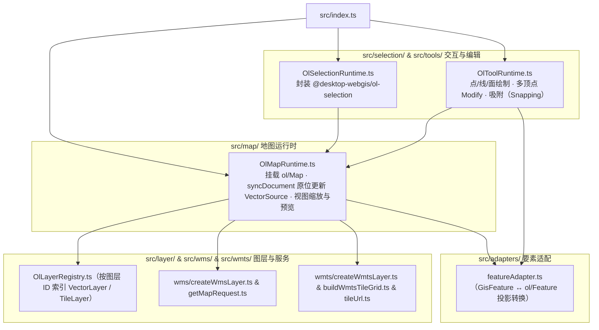

# @desktop-webgis/ol-runtime

服务于 Desktop 二维工作台的 OpenLayers 运行时封装（内部包），负责地图挂载、文档增量同步、WMS/WMTS 服务图层构建、选择高亮与几何绘制/节点编辑工具。

## 架构图



## 验证

```bash
pnpm --filter @desktop-webgis/ol-runtime build
pnpm --filter @desktop-webgis/ol-runtime test
```
