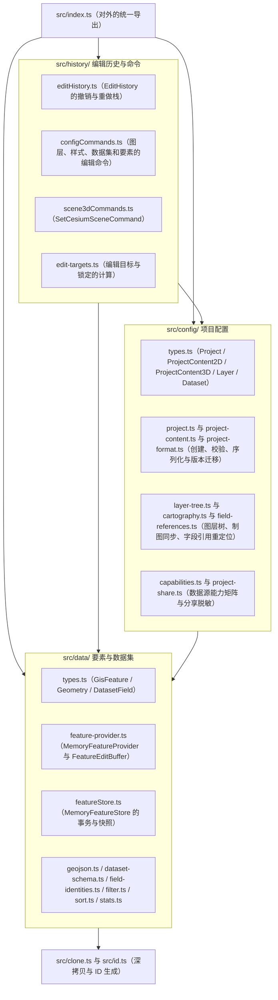

# @desktop-webgis/project

Desktop 的核心项目模型包（内部包），负责项目配置、内存中的要素数据 `Provider/Buffer`，以及统一的编辑命令和撤销历史。

## 内部架构图

`src/` 内部遵循严格的单向依赖：`history → config → data → 基础工具`，由 `pnpm check:architecture` 强制检查。



## 验证

```bash
pnpm --filter @desktop-webgis/project build
pnpm --filter @desktop-webgis/project test
```
