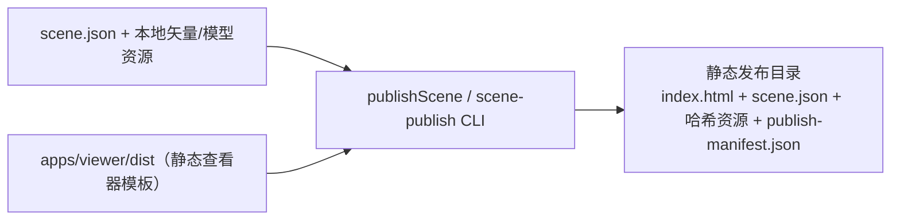

# @desktop-webgis/scene-publisher

Builds a portable static Viewer artifact from a validated `SceneManifest` / `SceneDocument`.

## 架构图



The publisher copies declared local resources, rejects unsafe paths, preserves remote map services as runtime URLs and writes a content-hashed `publish-manifest.json`. It never downloads or caches online basemap tiles.

```bash
scene-publish \
  --scene report.scene.json \
  --viewer apps/viewer/dist \
  --out publish/report \
  --public-url https://maps.example.com/report/
```

`--public-url` records the deployment address but does not upload files. Deploy the output directory to any static host. Provider secrets are accepted only through an explicitly supplied `--runtime-config` JSON file; do not commit that file.
