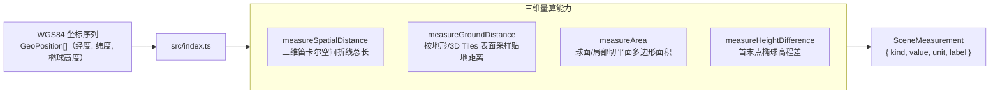

# @desktop-webgis/cesium-measure

无 UI 框架依赖的 Cesium 三维场景量算工具包（可发布通用包），支持空间距离、贴地距离、水平面积与高度差计算。

## 架构图



## 验证

```bash
pnpm --filter @desktop-webgis/cesium-measure build
pnpm --filter @desktop-webgis/cesium-measure test
```
