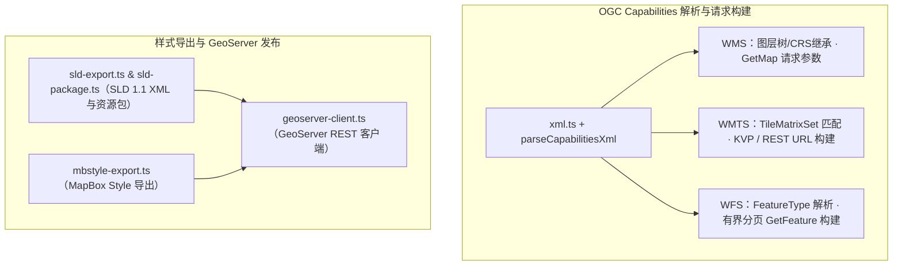

# @desktop-webgis/ogc-io

OGC service URL normalization, capabilities request helpers, and XML parsers for WMS / WMTS / WFS.

## 架构图

- Secrets (query tokens, Bearer values) are never written into fixtures, logs, or returned shareable URLs.
- `fetchCapabilitiesXml` is separate from `parseCapabilitiesXml`.
- Inject `fetch` (browser or Tauri native channel); this package does not open a public proxy or disable TLS.

P16: CRS/extent inheritance for WMS layers; ServiceExceptionReport mapping (`wms-service-exception.xml`).

P17: WMTS TileMatrix / style / format / KVP|REST resolve (`resolveWmtsLayerOptions`); fixtures cover non-numeric matrix IDs, 512px tiles, and REST templates.

P18: WFS 2.0/1.1 feature type + outputFormat + paging parse; `resolveWfsLoadOptions` / `buildGetFeatureRequestUrl` / bounded page plan; axis-order samples for BBOX; fixtures include 1.1.0 and GeoJSON GetFeature sample.
