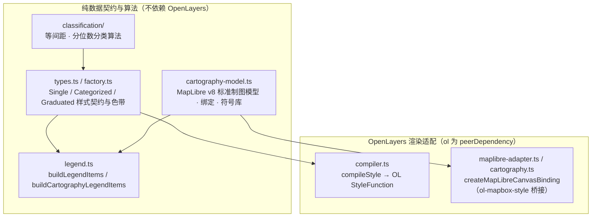

# @desktop-webgis/ol-style

OpenLayers 的样式工具包：可序列化为 JSON 的样式契约、分类与分级算法、标注、图例，以及可选的 OpenLayers StyleFunction 编译。

## 架构图



> 本阶段完成了**发布准备**（`pnpm pack` 加上工作区外的消费者校验）。**没有执行 npm publish**；真正发布之前，包名、scope、版本和许可证归属说明仍可能调整。

## 特性

- **分类算法**：等间距、分位数；`./classification` 入口不依赖 OpenLayers
- **样式契约**：`single` / `categorized` / `graduated`，可以安全地做 JSON 序列化
- **标注**：字段标注（字号、颜色、描边、偏移、缩放范围）
- **图例**：`buildLegendItems` 与已经应用的样式保持一致，不重新分类
- **颜色与符号**：插值色带，点线面和混合符号的工厂
- **OpenLayers 编译**：主入口 `compileStyle`（`ol` 为 peerDependency）

公开 API 只使用样式领域的术语（样式、符号、分类、分级、图例），不暴露 Desktop、项目文件路径这类应用内部的实现概念。

### 标准二维制图入口

`@desktop-webgis/ol-style/cartography-model` 提供纯数据的 Style Layer 绑定、旧样式迁移、标准校验、组装和图例。`@desktop-webgis/ol-style/cartography` 提供 `createMapLibreCanvasBinding`，按 GIS 图层的子集绑定标准的 v8 样式，复用已有的 OL VectorSource 并设置 `updateSource:false`，共享数据集不会重复创建要素。旧的主入口继续兼容原有的调用方。

Desktop 和 Viewer 的场景文档路径已经接入标准制图。设计基线见[二维制图系统技术设计 V1.1](../../../docs/design/2d-cartography-technical-design-v1.1.md)。

## 安装

```bash
pnpm add @desktop-webgis/ol-style
pnpm add ol@^10.10.0   # peerDependency（与本包验证过的版本一致）
```

如果还没有发布到 npm，可以用仓库内的 pack 包：

```bash
pnpm --filter @desktop-webgis/ol-style build
pnpm --filter @desktop-webgis/ol-style pack:check
# 在工作区外的临时项目里：
pnpm add ./desktop-webgis-ol-style-0.1.0.tgz ol@^10.10.0
```

一键校验（pack → 在工作区外安装 → 类型检查 → 运行示例）：

```bash
pnpm --filter @desktop-webgis/ol-style verify:consumer
```

## 使用

### 分类算法（无需 OpenLayers）

```typescript
import {
  classifyEqualInterval,
  classifyQuantile,
  classifyValue
} from '@desktop-webgis/ol-style/classification'

const values = [1, 2, 3, 4, 5, 6, 7, 8, 9, 10]

const equalResult = classifyEqualInterval(values, { numClasses: 5 })
console.log(equalResult.breaks)

const quantileResult = classifyQuantile(values, { numClasses: 5 })
console.log(quantileResult.breaks)

const classIndex = classifyValue(6.5, equalResult.breaks)
```

### 样式契约、标注与图例

```typescript
import {
  createSingleStyle,
  createCategorizedStyle,
  createGraduatedStyle,
  createPointSymbol,
  buildLegendItems,
  rgb,
  generateColorRamp
} from '@desktop-webgis/ol-style'

const singleStyle = createSingleStyle(
  createPointSymbol(5, rgb(255, 0, 0)),
  { field: 'name', fontSize: 12, color: rgb(20, 20, 20) }
)

const categorizedStyle = createCategorizedStyle(
  'type',
  [
    { value: 'A', symbol: createPointSymbol(5, rgb(255, 0, 0)) },
    { value: 'B', symbol: createPointSymbol(5, rgb(0, 255, 0)) }
  ],
  createPointSymbol(3, rgb(128, 128, 128)),
  { field: 'name', fontSize: 12, color: rgb(20, 20, 20) }
)

const colors = generateColorRamp(rgb(255, 255, 0), rgb(255, 0, 0), 5)
const graduatedStyle = createGraduatedStyle(
  'population',
  'quantile',
  colors.map((color, i) => ({
    value: (i + 1) * 1000,
    symbol: createPointSymbol(5, color)
  })),
  createPointSymbol(3, rgb(128, 128, 128))
)

const legend = buildLegendItems(categorizedStyle)
```

### 编译为 OpenLayers StyleFunction

```typescript
import { compileStyle } from '@desktop-webgis/ol-style'

const styleFunction = compileStyle(categorizedStyle)
vectorLayer.setStyle(styleFunction)
```

完整独立示例见 `examples/symbology-smoke`（分类，加等间距或分位数分级，加标注和图例）。

## 包入口

| 入口 | 内容 | OpenLayers |
| --- | --- | --- |
| `@desktop-webgis/ol-style` | 样式契约、工厂、编译器、图例，以及分类相关函数的再导出 | peer |
| `@desktop-webgis/ol-style/classification` | 纯分类算法 | 无 |

## 发布清单（准备项）

| 项 | 状态 |
| --- | --- |
| `exports` / `types` / `files` | 已审查 |
| `peerDependencies.ol` | `^10.10.0`（已验证） |
| `sideEffects` | `false` |
| `license` + `LICENSE` | MIT |
| `CHANGELOG.md` | 已添加 |
| 工作区外的 tarball 消费者 | `verify:consumer` |
| 真正的 npm publish | **未执行**（有意为之） |

## 开发

```bash
pnpm install
pnpm --filter @desktop-webgis/ol-style build
pnpm --filter @desktop-webgis/ol-style test
pnpm --filter @desktop-webgis/ol-style verify:consumer
```

## 约束

- **不依赖**：Desktop、project、scene-schema、React、Zustand、Tauri，以及任何 `workspace:*` 的运行时依赖
- **OpenLayers**：只作为 peerDependency；classification 入口完全独立
- **JSON 可序列化**：样式契约是纯数据

## 许可证

MIT
